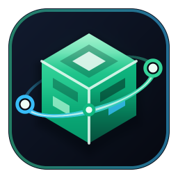

<div align="center">



# MineRelay

**Distributed Java Minecraft Server Host & Zero-Port-Forward Web Dashboard**

*Let anyone in your friend group host the exact same shared Minecraft world on their PC—with a single permanent join address, automatic cloud world sync, atomic host locking, and zero router port forwarding.*

[-10b981?style=for-the-badge&logo=windows)](https://github.com/NtC0der/MineRelay/releases/latest/download/MineRelay.exe)
[](https://www.python.org/)
[](https://www.minecraft.net/)

</div>

---

## Why MineRelay?

Playing on a self-hosted Minecraft server with friends usually hits a wall when the single friend hosting the world is offline. Paid hosting costs money every month, and sharing world zip files manually over chat leads to overwritten saves, `session.lock` corruption, and mismatched IPs.

**MineRelay solves this** with a lightweight local web dashboard (`http://localhost:3080`) paired with any synced shared folder (Google Drive, OneDrive, Dropbox, LAN share, or Git):

1. **Anyone with a Member Passkey can host the server when it's offline** — whichever friend wants to play clicks **▶ Host Server on My PC**.
2. **No Split-Brain / Overwritten Worlds** — an atomic lock (`host-lock.json`) with live heartbeats prevents two people from hosting at the same time.
3. **Zero Cloud-Sync World Corruption** — MineRelay pulls the snapshot (`snapshots/latest-server.zip`) into a fast local `./data/runtime-server` directory while playing, then zips and pushes changes back (with automatic backups) when stopped.
4. **Zero Port Forwarding & Same Join IP Every Time** — built-in `playit.gg` tunnel management shares the tunnel configuration via the sync folder, so friends outside your local network always join the exact same address (`*.gl.joinmc.link`) no matter which member is hosting!

---

## Quick Download (Windows Standalone `.exe` — No Python Needed)

1. Click **[Download MineRelay.exe](https://github.com/NtC0der/MineRelay/releases/latest/download/MineRelay.exe)** directly, or open the **[Releases Page](https://github.com/NtC0der/MineRelay/releases/latest)** and download `MineRelay.exe` under **Assets**.
2. Place `MineRelay.exe` in its own folder (e.g. `Desktop\MineRelay\MineRelay.exe`) and double-click it to launch.
3. Your browser will open automatically at **`http://localhost:3080`**.

> **Note:** When the server starts for the first time, MineRelay automatically downloads the matching Minecraft server JAR (Paper / Purpur / Vanilla), Portable Java Runtime (JRE 21 / JRE 25 as required by the version), and `playit.exe` inside `./data/bin/`.

---

## Key Features

- **Role-Based Passkey Authentication**
  - **1 Admin Account (`MC-ADMIN-XXXX-XXXX-XXXX`)**: Full dashboard access — configure `server.properties`, gamerules, world map & seed, plugins, files, backups, whitelist/OPs/bans, console commands, and member accounts.
  - **Member Host Accounts (`MC-HOST-XXXX-XXXX-XXXX`)**: Dedicated personal passkeys for friends allowing them to **Start, Stop, Restart, and Host** the server, copy the Join IP, and monitor live player counts—without exposing Admin controls or server files.
- **Distributed Host Lock & Auto Cloud Sync**
  - Works seamlessly with **Google Drive, OneDrive, Dropbox, LAN folders, or Git**.
  - **Customizable Periodic Drive Auto-Sync**: Configurable interval (minutes, or `0` to disable) flushes `save-off` → `save-all` → live snapshot upload → `save-on` safely while hosting so progress stays up to date in the cloud without stopping the server.
  - Hardened split-brain lock fencing, Google Drive conflict-folder (`locks (N)/`, `cluster-config (N).json`, `host-telemetry (N).json`) reconciliation, active cloud-transfer detection, and Zip-Slip safe snapshot extraction.
  - Incremental snapshot state tracking (`.sync-state.json`) with SHA-256 verification avoids redundant extraction on restarts while immediately detecting updates from remote hosts.
- **Zero-Port-Forward Networking (`playit.gg`)**
  - Integrated tunnel process manager & secret-key syncing so every host machine advertises the exact same public Minecraft join address.
- **Full Server Management Suite**
  - **World Map & Seed Generator**: Roll random 64-bit seeds or pick custom seeds, terrain presets (`Normal`, `Large Biomes`, `Amplified`, `Superflat`), structure toggles, and **Disable The End** (`allow-end: false` synced to `bukkit.yml` & `server.properties`), with pre-reset safety backups.
  - **Live Console & Player Telemetry**: Real-time SSE log streaming, command execution with history, ANSI stripping, join/leave tracking, OP/Whitelist/Kick/Ban management.
  - **Plugins & File Explorer**: 1-Click Modrinth plugin installer/toggler, inline file editor & uploader, recursive file & folder search, clickable ancestor breadcrumbs, and world backup manager.

---

## How To Set Up (Admin + Friends)

### 1. First-Time Cluster Setup (Admin)
1. Launch `MineRelay.exe` (or `start-dashboard.bat` from source).
2. Click **Change Folder** (if needed) and select a folder inside **Google Drive / OneDrive / Dropbox** that you share with your friends (e.g. `G:\My Drive\MineRelay-Shared`).
3. Switch to **Initialize New Server Cluster**, enter a server name and Admin username, and click **Create Cluster & Generate Admin Passkey**.
4. **Save your `MC-ADMIN-...` passkey safely.**
5. Open **Accounts & Passkeys** in the dashboard to generate unique `MC-HOST-...` passkeys for your friends.

### 2. Joining as a Friend / Member Host
1. Send your friend **[`MineRelay.exe`](https://github.com/NtC0der/MineRelay/releases/latest/download/MineRelay.exe)** (or the [Releases](https://github.com/NtC0der/MineRelay/releases/latest) link), the shared cloud folder invite, and their personal `MC-HOST-...` passkey.
2. When they open `MineRelay.exe`, they select that same synced shared folder and sign in with their `MC-HOST-...` passkey.
3. Whenever the server is **Idle**, they can click **▶ Host Server on My PC** to automatically download the latest world snapshot and start hosting!

---

## Running from Source

### Prerequisites
- Python **3.10+** (tested on Python 3.12 / 3.14)
- Windows (supports batch launcher & PyInstaller build; core server also runs on Linux/macOS)

### Launch Dashboard
```bash
git clone https://github.com/NtC0der/MineRelay.git
cd MineRelay
pip install -r requirements.txt
python -m src.server
```
Or simply double-click **`start-dashboard.bat`** on Windows. Open **`http://localhost:3080`**.

---

## Building the Standalone Executable

To compile a fresh single-file `dist/MineRelay.exe` with embedded web UI and app icon:

```bash
pip install pyinstaller psutil requests colorama
python build_exe.py
```

The compiled executable will be written to `dist/MineRelay.exe`.

---

## Project Structure

```text
├── public/                 # Frontend dashboard UI (HTML, CSS, Vanilla JS, SVG/ICO branding)
├── scripts/
│   └── generate_logo.py    # Generates SVG/PNG/ICO branding assets
├── src/
│   ├── server.py           # HTTP + SSE API server & request routing
│   ├── auth_service.py     # Passkey hashing, role-based access & thread-safe sessions
│   ├── sync_engine.py      # Distributed host lock, snapshot zip sync & cloud helpers
│   ├── minecraft_manager.py# Process lifecycle, world generator, properties, files & plugins
│   ├── tunnel_manager.py   # playit.gg zero-port-forward binary & secret key manager
│   ├── bootstrap_runtime.py# Auto Paper/Vanilla/Purpur JAR, Paperclip cache & Java JRE installer
│   └── models.py           # ClusterConfig, HostLock, UserAccount & null-safe models
├── tests/
│   ├── verify_all.py               # 19+ end-to-end functional, security & UI integration tests
│   ├── test_stage2_e2e.py          # Periodic Drive auto-sync, lock/transfer safety & mirroring suite
│   ├── test_concurrent_player_api.py
│   ├── test_stress_player_monitor.py
│   ├── stress_api_sse.py
│   └── test_empirical_challenger2.py
├── build_exe.py            # PyInstaller single-file Windows executable builder
├── requirements.txt        # Python dependencies
└── start-dashboard.bat     # Windows source launcher
```

---

## Running Automated Tests

```bash
python tests/verify_all.py
python tests/test_stage2_e2e.py
python tests/test_concurrent_player_api.py
python tests/test_stress_player_monitor.py
python tests/stress_api_sse.py
python tests/test_empirical_challenger2.py
```
